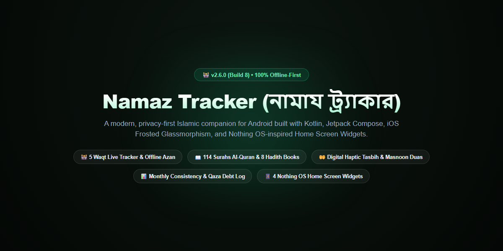
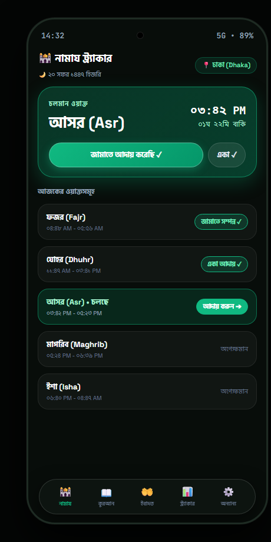
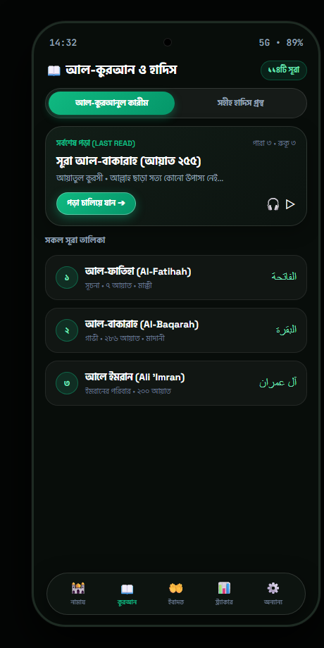
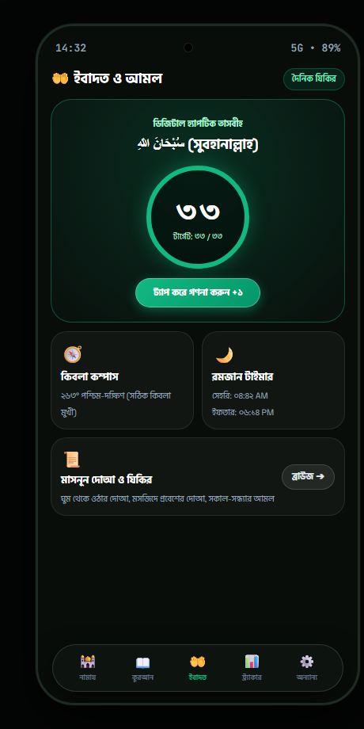
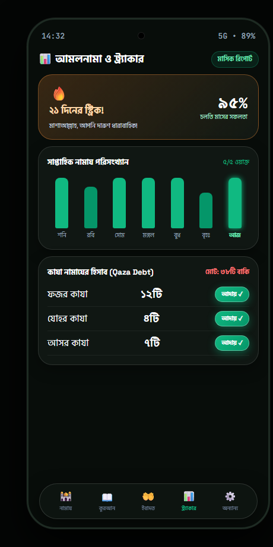
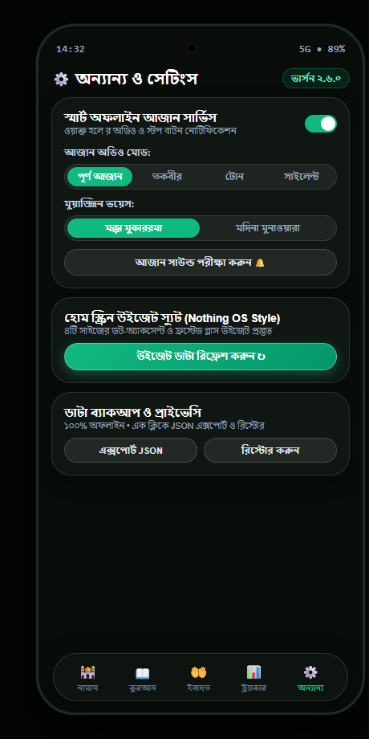
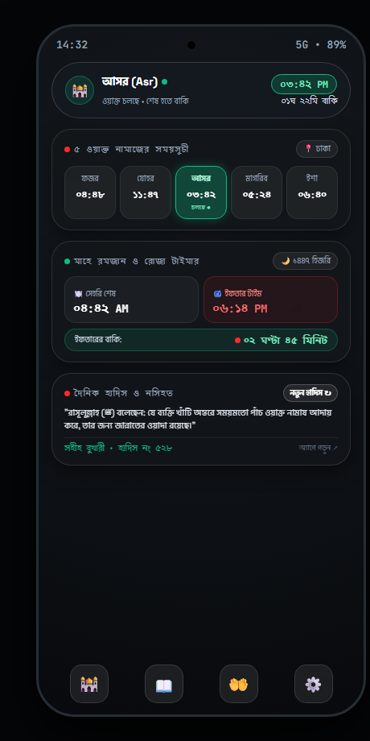

<div align="center">

# 🕌 Namaz Tracker (নামায ট্র্যাকার)
### Modern Offline-First Islamic Companion & Spiritual Habit Tracker for Android

[-emerald?style=for-the-badge&logo=android)](app/build.gradle.kts)
[](app/build.gradle.kts)
[](https://kotlinlang.org/)
[](https://developer.android.com/jetpack/compose)
[](app/src/main/assets/)
[](LICENSE)

<br/>



</div>

---

## 📱 App Screenshots (প্রতিটি ট্যাবের ভিজ্যুয়াল প্রিভিউ)

| 🕌 নামায ও ওয়াক্ত ট্র্যাকার | 📖 আল-কুরআন ও হাদিস | 🤲 ইবাদত ও আমল |
| :---: | :---: | :---: |
|  |  |  |
| **১. নামায ট্যাব (Home)**<br/>চলতি সক্রিয় ওয়াক্ত, লাইভ রিভার্স কাউন্টডাউন ও ৫ ওয়াক্তের এক-ট্যাপ স্ট্যাটাস লগ | **২. কুরআন ও হাদিস ট্যাব**<br/>১১৪টি পূর্ণাঙ্গ সূরা, অডিও তিলাওয়াত, বাংলা অনুবাদ ও সহীহ হাদিস গ্রন্থ | **৩. ইবাদত ও আমল ট্যাব**<br/>ডিজিটাল হ্যাপটিক তাসবীহ, ৩৬০° কিবলা কম্পাস ও মাসনূন দোআ |

<br/>

| 📊 আমলনামা ও ট্র্যাকার | ⚙️ সেটিংস ও স্মার্ট আজান | 📱 নাথিং ওএস উইজেট স্যুট |
| :---: | :---: | :---: |
|  |  |  |
| **৪. ট্র্যাকার ও এনালাইটিক্স**<br/>ধারাবাহিকতার স্ট্রিক, সাপ্তাহিক নামায চার্ট ও লাইফটাইম কাযা ডেট ট্র্যাকার | **৫. সেটিংস ও স্মার্ট আজান**<br/>অফলাইন আজান অডিও, মুয়াজ্জিন চয়েস ও ওয়ান-ট্যাপ JSON ডাটা ব্যাকআপ | **৬. হোম স্ক্রিন উইজেট স্যুট**<br/>Nothing OS ডট-অ্যাকসেন্ট সমৃদ্ধ ৪টি ভিন্ন সাইজের কাস্টমাইজড উইজেট |

---

## 🌟 মূল বৈশিষ্ঠ্যসমূহ (Key Features)

### 🕌 ১. ৫ ওয়াক্ত নামায ট্র্যাকার ও লাইভ কাউন্টডাউন
- **সঠিক ওয়াক্ত গণনা:** বাংলাদেশের সকল জেলা ও বৈশ্বিক জিপিএস কো-অর্ডিনেট অনুযায়ী হানাফী ও শাফেয়ী উভয় মাযহাবে ওয়াক্তের নির্ভুল হিসাব।
- **এক-ট্যাপ স্ট্যাটাস লগিং:** জামাআত, একা আদায়, কাজা, কিংবা মিসড—ইনস্ট্যান্ট ট্যাপে লগ সংরক্ষণ।
- **স্মার্ট আজান সার্ভিস:** ওয়াক্ত হওয়ার সাথে সাথে ব্যাকগ্রাউন্ড অডিও আজান ও নোটিফিকেশনে ইনস্ট্যান্ট **'স্টপ আজান'** বোতাম।

### 📖 ২. সম্পূর্ণ আল-কুরআনুল কারীম ও সহীহ হাদিস
- **১১৪টি পূর্ণাঙ্গ সূরা:** আরবি আয়াত, সহজ বাংলা অনুবাদ, ইংরেজি অর্থ এবং বাংলা উচ্চারণ (ট্রান্সলিটারেশন)।
- **লাস্ট রিড রিজ্যুম:** যেকোনো সময় অ্যাপ খুলে পূর্বে যেখানে পড়া শেষ করেছিলেন সেখান থেকেই পুনরায় শুরু করার সুবিধা।
- **৮টি বৃহৎ সহীহ হাদিস গ্রন্থ:** সহীহুল বুখারী, সহীহ মুসলিম, সুনান আন-নাসায়ী, আবু দাউদ, জামে আত-তিরমিযী, ইবনে মাজাহ, মুয়াত্তা মালিক ও মুসনাদে আহমাদ।

### 🤲 ৩. ডিজিটাল হ্যাপটিক তাসবীহ ও কিবলা কম্পাস
- **স্পর্শীয় হ্যাপটিক কাউন্টার:** ৩৩ ও ১০০ চক্রে বিশেষ ভাইব্রেশন ও স্প্রিং অ্যানিমেশন।
- **রিয়েল-টাইম সেন্সর কম্পাস:** ডিভাইসের ম্যাগনেটিক সেন্সর ব্যবহার করে পবিত্র কাবা শরীফের সঠিক দিকনির্দেশনা।
- **মাসনূন দোআ ও রমজান টাইমার:** দৈনন্দিন প্রয়োজনীয় দোআ এবং সাহরী ও ইফতারের রিয়েল-টাইম কাউন্টডাউন।

### 📱 ৪. নাথিং ওএস ও আইওএস গ্লাস মাল্টি-উইজেট স্যুট (Home Screen Widgets)
1. **চলতি ওয়াক্ত ক্যাপসুল (৪x১ / ২x১):** বর্তমান নামাজের নাম, সময় ও লাইভ রিমেইনিং কাউন্টডাউন।
2. **৫ ওয়াক্ত নামাজের বোর্ড (৪x২):** এক নজরে পাঁচ ওয়াক্তের পূর্ণ সময়সূচী ও বর্তমান ওয়াক্তের গ্লোয়িং ফ্রস্টেড পিল হাইলাইট।
3. **মাহে রমজান টাইমার (৪x২ / ৩x২):** আজকের সেহরি ও ইফতারের সঠিক সময় এবং অবশিষ্ট কাউন্টডাউন।
4. **দৈনিক হাদিস রিডার (৪x২):** হোম স্ক্রিনে উইজেটের উপর থেকেই **'নতুন হাদিস ↻'** বোতামে এক ট্যাপে নতুন হাদিস পড়ার সুবিধা।

### 🔒 ৫. শতভাগ অফলাইন ও ডাটা প্রাইভেসি
- **১০০% অন-ডিভাইস:** কোনো অ্যাকাউন্ট বা ক্লাউড সার্ভার ট্র্যাকিং নেই। আপনার যাবতীয় আমল ডিভাইসেই সুরক্ষিত।
- **JSON ব্যাকআপ ও রিস্টোর:** এক ক্লিকে সম্পূর্ণ ডাটাবেজ ব্যাকআপ ফাইল ডাউনলোড ও নতুন ফোনে রিস্টোর করার সুবিধা।

---

## 🛠️ টেকনিক্যাল স্পেসিফিকেশন (Tech Stack)

| উপাদান | প্রযুক্তি |
| :--- | :--- |
| **ভাষা (Language)** | Kotlin 2.0+ |
| **ইউআই ফ্রেমওয়ার্ক (UI Toolkit)** | Jetpack Compose (Material 3 + Custom iOS Frosted Glass Primitives) |
| **ডিজাইন সিস্টেম** | iOS Frosted Glassmorphism (`IosGlassPill.kt`) & Nothing OS Dot-Matrix Widgets |
| **আর্কিটেকচার** | Clean Architecture + MVVM + StateFlow |
| **লোকাল ডাটাবেজ** | AndroidX Room Database 2.6.1 (`namaz_tracker.db` prepackaged SQLite) |
| **ব্যাকগ্রাউন্ড সার্ভিস** | Foreground Media Playback Service (`AzanPlaybackService.kt`) |
| **টেস্টিং ফ্রেমওয়ার্ক** | Robolectric 4.16+, JUnit4, Compose UI Test Rule |
| **প্যাকেজ নেম** | `com.namaztracker.app` |

---

## 🚀 ইনস্টলেশন ও রান করার নিয়ম

1. রিপোজিটরিটি ক্লোন করুন:
   ```bash
   git clone -b android https://github.com/Muhit47/namaz-tracker.git
   ```
2. **Android Studio** (Koala / Ladybug বা লেটেস্ট) দিয়ে প্রজেক্টটি ওপেন করুন।
3. গ্রেডল সিঙ্ক শেষ হওয়া পর্যন্ত অপেক্ষা করুন।
4. কানেক্টেড অ্যান্ড্রয়েড ফোন অথবা এমুলেটরে (Android 8.0+ / API 24+) রান করুন।

---

## 📜 লাইসেন্স (License)
বিশ্বব্যাপী মুসলিম ভাই-বোনদের দৈনন্দিন ইবাদতের সহায়তায় উন্মুক্ত সোর্সকৃত। [MIT License](LICENSE)-এর অধীনে লাইসেন্সপ্রাপ্ত।
